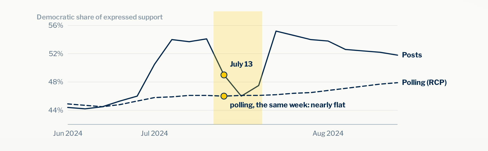
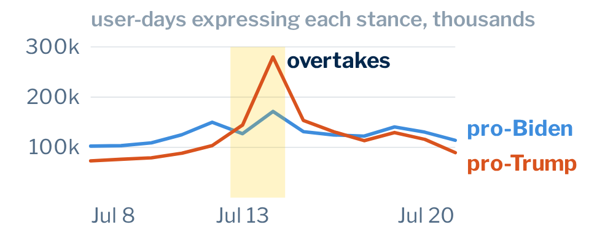
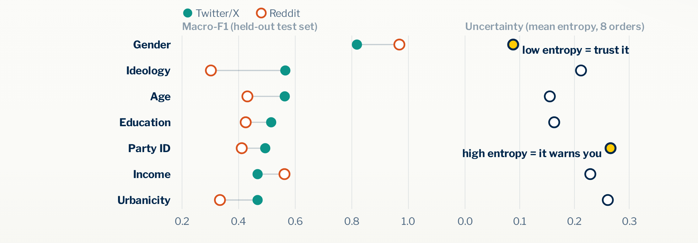
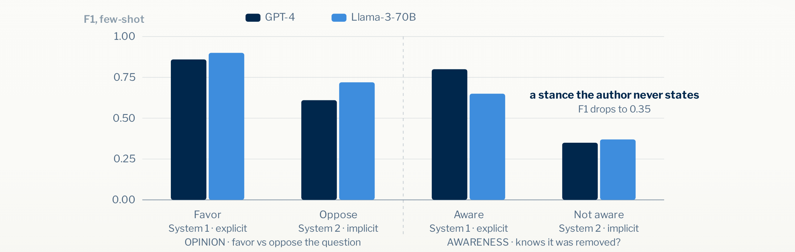
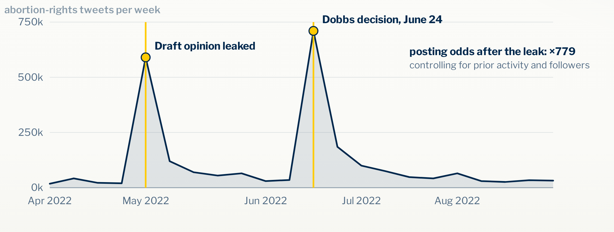
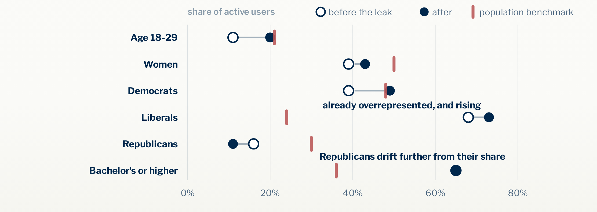
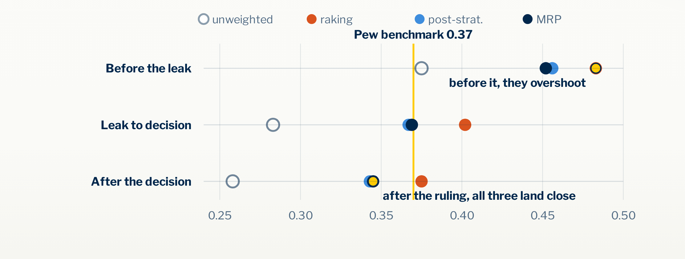
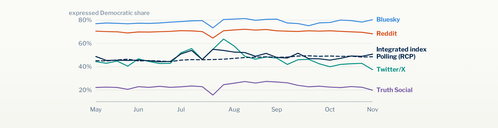

A poll asks a sample of perhaps a thousand people a question and reports, a week or two later, what the country thinks. A social media feed shows millions of people talking about politics in their own words, as events happen, at no cost to anyone who wants to collect it. For about fifteen years, researchers have asked whether the feed can stand in for the poll. If the feed already contains public opinion, why wait for the poll?

The question deserves an ambitious answer. The four studies of my dissertation (Li, 2026) work through it from the bottom up: who is posting, what the posts say, who chooses to speak when something happens, and what changes from one platform to the next. The short version is that social media measures something real, it is a different thing from what a poll measures, and the difference is the most useful part.

<nav class="toc">

Contents

<ol>
<li><a href="#field">Earlier studies of opinion in posts</a></li>
<li><a href="#july">One week in July 2024</a></li>
<li><a href="#expression">Preference and expression</a></li>
<li><a href="#inference">Inferring who posted and what they meant</a></li>
<li><a href="#dobbs">Who posts after a major event</a></li>
<li><a href="#platforms">Expression across four platforms</a></li>
<li><a href="#division">Social media as a complement to surveys</a></li>
<li><a href="#limits">Limits and open questions</a></li>
</ol>
</nav>

<h2 id="field">Earlier studies of opinion in posts</h2>

The early work was optimistic, and for understandable reasons. O'Connor and colleagues (2010) took tweets that mentioned jobs and the economy, scored the words in them as positive or negative, and compared the daily score with survey measures of consumer confidence and presidential approval. In some series the two moved together closely. The same year, Tumasjan and colleagues (2010) counted how often German parties were mentioned on Twitter before a federal election and found that the shares of mentions came close to the parties' vote shares. Counting posts seemed to work.

The results did not travel well. Gayo-Avello (2013) reviewed the studies that predicted elections from Twitter and found that apparent success often rested on a favorable choice of election, a weak baseline, or decisions about keywords, time windows and which users to include. Conrad and colleagues (2021) followed one of the early series, Twitter sentiment about jobs against a survey of opinion about the economy, and found that the agreement between the two weakened over time. Jungherr and colleagues (2017) compared Twitter activity with election outcomes in Germany and concluded that posts tracked attention to politics more reliably than they tracked support for any party.

These findings point to a question the typical study does not ask out loud. A study collects posts on a topic, labels them, and reports what share of them express one view or another. That share describes the posts. To describe the public, the study needs to know who wrote the posts, which population those writers belong to, and why these people spoke while others stayed silent. Researchers in survey methodology have raised this point for years. Hsieh and Murphy (2017) listed the ways a Twitter sample departs from a population, starting with the many people who are not on the platform at all. Pew Research Center found that 10 percent of adult Twitter users produced 80 percent of the tweets (Wojcik and Hughes, 2019). Schober and colleagues (2016) pointed out that survey respondents and social media users understand themselves to be doing different things. A respondent answers because someone asked, and a user posts because they want to.

A careful look at a few hundred posts can still show how people talk about an issue, which arguments they reach for, and what worries them. The trouble starts when that kind of description quietly turns into a claim about the population, when "the posts we collected" becomes "Americans think".

<h2 id="july">One week in July 2024</h2>

On July 13, 2024, a gunman tried to kill Donald Trump at a rally in Pennsylvania. Over the following days, the share of election posts that supported the Democratic candidate fell sharply. On Twitter/X it dropped from about 60 percent to 36 percent before it recovered. An index that combines four platforms, built in the fourth study of the dissertation, shows the same fall.

*Figure 1. The Democratic share of posts that expressed support for a candidate, combined across Bluesky, Reddit, Truth Social and Twitter/X (solid line), against the RealClearPolitics polling average (dashed line). The shaded band marks the week after July 13. Source: Li (2026), Chapter 5.*

If the feed were a poll, a large part of the Democratic coalition would have walked away in a few days. Polling over the same week barely moved. Either the posts or the polls are misleading, and the natural suspicion falls on the posts. Perhaps Democratic supporters simply went quiet after the attack, out of shock or respect.

They did not. Posts supporting Biden rose on every platform the following week, by 12 to 42 percent depending on the platform. What changed was posting on the other side. Posts supporting Trump or attacking Biden rose faster and further, especially on Twitter/X.

*Figure 2. Users posting in support of each candidate per day, in thousands. Supportive posting rose for both candidates after July 13, and posting for Trump rose much more. Source: Li (2026), Chapter 5.*

The Democratic share fell because the denominator grew. The attack moved Trump's supporters to speak, and for a few days the people expressing any preference at all were disproportionately his base. Taken as a poll, the week shows a collapse in Democratic support. Taken as a record of who spoke, it shows a burst of mobilization on the other side, which is close to the opposite claim. Both descriptions come from the same number.

<h2 id="expression">Preference and expression</h2>

The July week makes a distinction concrete that the rest of this essay relies on. A survey measures *preference*: the attitude a person holds, recorded because a sampled person was asked. A collection of posts measures *expression*: the positions people choose to make public. A preference can exist without ever being expressed, and the choice to express it depends on more than the preference itself. It depends on whether the person uses the platform, whether the topic feels urgent today, whether the person expects to be heard or attacked, and whether something has just happened that makes silence feel wrong.

So expression is preference plus a decision to speak. The decision is rarely independent of the opinion it reveals. People with sharper views post more. People who feel their side has just lost, or just been threatened, post more. An event can change who speaks in a single afternoon while leaving what people prefer untouched.

This changes what the gap between a feed and a poll means. When the two disagree, the gap is usually treated as error in the posts, something to correct or explain away. Under this distinction, the gap is a measurement of the decision to speak: who moved into the conversation, who left it, and how they framed what they said. In July 2024 the gap measured the mobilization of one candidate's base. That is a fact about American politics, and no poll that week recorded it.

To use the gap this way, a researcher needs two capabilities that the early studies did not have. A researcher has to know who is speaking and what each post actually says. A researcher also has to know when the people speaking stand in for anyone beyond themselves.

<h2 id="inference">Inferring who posted and what they meant</h2>

No one can read millions of posts by hand, so every claim about what a platform's users express rests on tools that label the posts at scale. Large language models now do most of this work. They are good at it, and their errors fall in predictable places, which matters more than their average accuracy.

### The person who posted

Most posts carry no age, income or party label. To learn who is posting, a researcher has to infer these characteristics from the text. The first study of the dissertation built such a tool and tested it against people whose characteristics were known. Members of the Ipsos KnowledgePanel, a probability-based national panel, shared their Twitter/X or Reddit handles: 1,410 Twitter/X users and 893 Reddit users, about a million tweets and 300,000 Reddit posts in all. Their self-reported demographics served as the ground truth.

The tool, a fine-tuned large language model, predicts eight attributes for each user one after another, so that each prediction can use the earlier ones. Education helps predict income, and both help predict ideology. Because the order of the attributes changes the predictions, the tool runs eight times, each time in a different random order. When the eight runs agree on a user's label, the label is trustworthy. When they disagree, the spread of their answers measures how uncertain the label is. The study measures that spread with entropy, which is zero when every run gives the same answer and grows as the answers scatter.

*Figure 3. Left, how well the tool recovers each attribute (macro F1 on held-out users, Twitter/X and Reddit). Right, how much its eight runs disagree (mean entropy). Gender is recovered almost perfectly and with little disagreement. Party identification, income and urbanicity are recovered poorly and with the most disagreement. Source: Li (2026), Chapter 2.*

Gender comes through clearly in language and reached an F1 of 0.97 on Reddit. Party identification stayed near or below 0.55 on both platforms. Liberal language does not tell a model whether its author calls themself a Democrat or an Independent, and many people who call themselves moderate belong to either party. The useful result is that the tool's disagreement with itself rises exactly where its accuracy falls. Entropy was highest for party identification, urbanicity and income, and lowest for gender and metro status. A researcher can set a threshold on entropy and exclude the uncertain labels, flag them, or give them less weight before they enter any estimate of a group.

This matters because the labels do not stay inside the tool. Later in this essay, inferred ideology decides how much weight each poster receives when posts are adjusted to look like the population. An error in that label moves the adjusted estimate, and the researcher sees only the estimate. The entropy score keeps the error visible at the point where it enters. The study recommends reporting, for every inferred attribute used later, how many labels pass the threshold and whether the conclusion survives when the threshold moves.

### The stance a post takes

A second tool labels the stance a post takes. The second study of the dissertation compared large language models with crowdsourced human coders on posts about a contested question: whether the 2020 Census would ask about citizenship (Li, 2026; Li and Conrad, 2024). From about 3.5 million tweets about the Census, 1,000 posts on the citizenship question were each labeled by ten people. For each post, coders and models recorded whether its author favored or opposed the question, and whether the author knew the question had been dropped from the census form.

Some posts state a position outright. "Only US citizens should be counted in the census" leaves nothing to infer. Others leave the position for the reader to work out. "There are good people working at the Census Bureau with me, trying to count our citizens" sounds friendly, and coders labeled its author as unaware of the decision, because the sentence assumes the citizenship question is still on the form. The study borrows Kahneman's (2011) terms for the two kinds of judgment: an explicit stance can be recognized quickly, which is System 1 work, and an implicit stance has to be reasoned out, which is System 2 work.

*Figure 4. Few-shot F1 for GPT-4 and Llama-3-70B by stance category. Both models do well when the stance is explicit (favor, aware) and much worse when it has to be inferred (oppose, not aware). Source: Li (2026), Chapter 3.*

On explicit posts the best models matched the crowd well: GPT-4 reached an F1 of 0.86 for posts favoring the question. On the hardest implicit category, authors who did not know the question had been dropped, GPT-4 reached 0.35 and Llama-3-70B reached 0.37. Human coders also disagreed most on those same posts. A single overall agreement rate between people and models therefore depends on how many implicit posts a corpus contains. The share of implicit posts varies with the topic and with the norms of the platform, so the same model can look excellent on one collection and unreliable on another.

Both tools lead to the same rule. An inferred label should arrive with a measure of how much to trust it, and an analysis built on many labels should report how its conclusion changes when the uncertain ones are treated differently. With that rule in place, the tools can answer the harder question: when do the people posting stand in for anyone else?

<h2 id="dobbs">Who posts after a major event</h2>

A natural hope runs through much of the work on social media opinion. Everyday political talk online comes from a small, unusual group of heavy users. A big public event might pull ordinary people into the conversation, and for a while the crowd might look more like the public. If so, the best moments to measure opinion from posts would be the moments everyone is talking.

The third study tested this hope on the clearest case available. On May 2, 2022, Politico published a leaked draft of the Supreme Court's decision in *Dobbs v. Jackson Women's Health Organization*, and on June 24 the Court overturned *Roe v. Wade*. The study collected tweets about abortion rights from April through August 2022 from the University of Michigan's Twitter Decahose, kept tweets about abortion rights from users in the United States, and ended with 6,731,092 tweets from 779,687 users.

*Figure 5. Weekly tweets about abortion rights. Posting surged after the leak and again after the decision. Controlling for each user's earlier activity and followers, the odds that a user posted in the months after the leak were about 779 times the odds before it. Source: Li (2026), Chapter 4.*

The event did change who posted, and by a lot. It did not make the crowd more like the public. Some groups moved toward their share of the population: the share of posters aged 60 and over fell from 35 percent to 21 percent, and the share of women rose from 39 to 43 percent against a population share of about half. Other groups moved the wrong way. Liberals were 68 percent of posters before the leak and 73 percent after it, against roughly 24 percent of the population. Republicans fell from 16 to 11 percent against roughly 30 percent. About 65 percent of posters held a bachelor's degree in both periods, against 36 percent of adults.

*Figure 6. Share of active users before the leak (open circles) and after it (filled circles, with the leak and the decision pooled), with the population benchmark in red (ACS and Pew Research Center). Age and gender moved toward the benchmark. Ideology and party moved away from it. Source: Li (2026), Chapter 4.*

The event did not raise participation evenly. It activated the people for whom the decision was urgent: before the leak, *Roe* was settled law, and the people posting about abortion were disproportionately those who wanted it changed. When the leak signaled that *Roe* would fall, supporters of legal abortion poured in. The crowd grew larger and changed shape.

### Adjusting the sample to the population

Survey researchers have a standard answer to an unrepresentative sample. If young people are overrepresented, give each young respondent less weight and each older respondent more, until the sample matches the population on age, gender, education and the other characteristics the population figures provide. Raking, poststratification and multilevel regression with poststratification (MRP; Gelman, 1997) are versions of this idea. The tools from the previous section make it possible here, because they supply each poster's inferred characteristics.

The study compared each adjusted estimate of the share of people who think abortion should be illegal with a Pew Research Center benchmark of 0.37.

*Figure 7. The share opposing legal abortion estimated from posts: unweighted, and adjusted by raking, poststratification and MRP, before the leak, between the leak and the decision, and after the decision. The yellow line is the Pew benchmark. Source: Li (2026), Chapter 4.*

After the decision, the adjustments worked. Poststratification gave 0.343 and MRP 0.345, close to the benchmark, while the unweighted posts gave 0.258. Before the leak, the result was stranger. The unweighted posts happened to land almost on the benchmark, at 0.375. Every adjustment pushed the estimate away from it. Raking gave 0.483, and poststratification and MRP gave about 0.45.

Before the leak, older people were underrepresented among posters, so every adjustment gave each older poster more weight. But the older people who posted about abortion at that time were overwhelmingly those who opposed it, which is far from true of older Americans in general. Giving them more weight multiplied an unusual group instead of restoring an ordinary one. Weighting can fix the mix of ages, genders and education levels in a sample. It cannot fix who chose to speak within each of those groups, and when the decision to speak depends on the opinion being measured, no demographic adjustment removes the bias. After the decision, enough new people of every stance entered the conversation that each group contained a fair spread of views, and the adjustment had something sound to work with.

So the answer to "does social media represent the public?" has no fixed value. It depends on who is posting at a given moment, and that changes with the event. Adjustment helps when participation is broad and can hurt when participation is selective. A researcher who adjusts a selective sample and checks only that its age, gender and education match the population can end up more confident and further from the truth.

<h2 id="platforms">Expression across four platforms</h2>

Most social media research has studied one platform, usually Twitter, because its data were open. By 2024 political talk had spread across several platforms with very different users. Bluesky drew a largely liberal crowd looking for a Twitter replacement, Truth Social a largely conservative one, Reddit organized talk into topical communities, and Twitter/X remained the most mixed. The fourth study collected posts naming the presidential candidates on all four platforms from May 1 to Election Day, 2024: about 44 million posts from about 4.8 million users.

The platforms also hold different kinds of people under the same label. Among users the tool inferred to be conservative, 85 percent of those on Bluesky expressed support for Harris, against 19 percent of those on Truth Social. Reweighting each platform to the same ideological and demographic targets left the gap between Bluesky and Truth Social essentially unchanged, at 64.8 points before adjustment and 65.3 after. On Reddit, by contrast, adjustment lowered Democratic support from 75.0 to 57.0 percent, because Reddit's lean comes largely from who uses it. A label such as "conservative" describes a different public on each platform, and adjustment cannot equalize what the measured characteristics do not capture.

The difference shows up in how each group moves as well as in its level. On Truth Social, conservatives post among people who already agree with them, and their expressed support moves with how enthusiastic that base feels. On Twitter/X, conservatives share the platform with liberal users and with contested news coverage, and their posts rose and fell with the campaign's events. When Democratic support dipped, conservatives on Twitter/X pushed the aggregate down more than conservatives on Truth Social did. The conservatives who stayed on Twitter/X were the more oppositional and reactive group, which is the reverse of what the platforms' reputations would suggest.

An obvious move is to pool the four platforms into one large collection. Pooling makes Twitter/X about 53 percent of the data, so the largest platform sets the result, and it averages away exactly the differences that carry information. The study instead measured and adjusted each platform separately, removed each platform's persistent level, and then combined the four adjusted series. A movement shared by all four platforms reflects the campaign. A movement in only one points to something happening on that platform.

*Figure 8. Expressed Democratic share on each platform, the integrated index built from the four adjusted series, and the RealClearPolitics polling average. No single platform looks like the country. The integrated index follows polling over weeks and departs from it in short episodes. Source: Li (2026), Chapter 5.*

The integrated index followed the polling average over weeks: a rise around the switch from Biden to Harris, a softening around the September debate, and a recovery into November. It departed from polling only in short episodes such as the July week, and it showed no lasting drift away from it. The polls and the index share calibration targets, so their agreement is a consistency check. Once the shared movement is separated from each platform's own movement, every departure becomes a question with an answer: did different people start posting, did the same people change how they talked, or did support itself shift?

<h2 id="division">Social media as a complement to surveys</h2>

The clearest answer to that question came from Bluesky in the autumn of 2024. In September, Bluesky's expressed support for Harris fell below the trend shared by the other platforms. Taken as a poll, it would look like liberals drifting away from their candidate. The posts themselves told a different story. Many left-leaning users were troubled by the Democratic ticket's position on Israel and Gaza, and they debated whether they could vote for Harris at all. One wrote that Gaza "might lose her Michigan". In October the same users resolved the dilemma by comparison: "You can have Harris who might not be great on Gaza but at least gives them something, or Trump who will ultimately give them nothing." Expressed support recovered.

The study calls this *expressive dissent*: voicing disagreement with one's own side without abandoning it. The posts gave no sign of a move toward Trump. What moved was how these users justified their vote and whether they wanted to voice support for it at all. A standard survey question about candidate preference would have counted them as Harris supporters in September and in October, and the reservation behind the vote would have disappeared from the record.

This points to a division of labor between the two kinds of evidence. A survey estimates how widely a preference holds in a defined population. It cannot easily see a feeling it never asked about. A feed shows, in people's own words and as it happens, which feelings and arguments are in play, who is moved to speak, and when. The feed can discover the question the survey should ask, for instance whether a vote is cast more for one's candidate or against the opponent. The survey can then measure how widely that sentiment holds. Used this way, each source covers what the other cannot.

The division also holds for timing. A survey can follow day to day shifts only by fielding very often, which is costly and slow. A feed records them as they happen. Combined across platforms and adjusted, posts can supply that fast layer: how mobilization and framing respond to events within hours, alongside the slower and more reliable survey estimate of where preferences stand.

The same division applies to the July week. Polls said that preferences held steady. The posts said that one side had been mobilized. Both were true, and together they describe that week better than either does alone.

<h2 id="limits">Limits and open questions</h2>

One limit is silence. Every method in this essay works with people who posted. The decision to speak can be modeled, but the views of people who never post on a topic leave nothing in the data, and for many questions they are most of the public.

A second limit is the medium. These studies used text that names a candidate or an issue. A growing share of political talk happens in images, video and audio, and much of it never names its subject. Measuring expression in those forms needs new tools and new checks on them.

A third limit is the setting. The events studied here, *Dobbs* and the 2024 election, are among the most visible moments in recent American politics, chosen because they make the mechanisms easy to see. Routine issues, quieter periods and other countries may show different patterns of who speaks and when.

A fourth limit is the labels themselves. The characteristics and stances in every study are inferred, and the uncertainty measures keep the error visible without removing it. The error matters most for inferred ideology, which drives both expressed support and the adjustments built on it.

The question this essay began with, whether social media can tell us what the public thinks, turns out to have a better version. Social media tells us who speaks, when, on which platform and in what terms, and how those choices respond to events. That record complements the survey, and the gap between the two, measured with care, shows who spoke, when, and why. My current work continues from here, on the [research page](../research.html).

### References

Conrad, F. G., Gagnon-Bartsch, J. A., Ferg, R. A., Schober, M. F., Pasek, J., and Hou, E. (2021). Social media as an alternative to surveys of opinions about the economy. *Social Science Computer Review*, 39(4), 489 to 508. [https://doi.org/10.1177/0894439319875692](https://doi.org/10.1177/0894439319875692)

Gayo-Avello, D. (2013). A meta-analysis of state-of-the-art electoral prediction from Twitter data. *Social Science Computer Review*, 31(6), 649 to 679. [https://doi.org/10.1177/0894439313493979](https://doi.org/10.1177/0894439313493979)

Gelman, A. (1997). Poststratification into many categories using hierarchical logistic regression. *Survey Methodology*.

Hsieh, Y. P., and Murphy, J. (2017). Total Twitter error. In *Total Survey Error in Practice*, 23 to 46.

Jungherr, A., Schoen, H., Posegga, O., and Jürgens, P. (2017). Digital trace data in the study of public opinion: An indicator of attention toward politics rather than political support. *Social Science Computer Review*, 35(3), 336 to 356. [https://doi.org/10.1177/0894439316631043](https://doi.org/10.1177/0894439316631043)

Kahneman, D. (2011). *Thinking, Fast and Slow*.

Li, M. (2026). *The Expressed Public: Political Opinion on Social Media in the Age of Large Language Models*. Doctoral dissertation, University of Michigan. [https://doi.org/10.7302/dspace/30597](https://doi.org/10.7302/dspace/30597)

Li, M., and Conrad, F. G. (2024). Advancing annotation of stance in social media posts: A comparative analysis of large language models and crowd sourcing. arXiv:2406.07483. [https://arxiv.org/abs/2406.07483](https://arxiv.org/abs/2406.07483)

O'Connor, B., Balasubramanyan, R., Routledge, B., and Smith, N. (2010). From tweets to polls: Linking text sentiment to public opinion time series. *Proceedings of the International AAAI Conference on Web and Social Media*, 4, 122 to 129. [https://doi.org/10.1609/icwsm.v4i1.14031](https://doi.org/10.1609/icwsm.v4i1.14031)

Schober, M. F., Pasek, J., Guggenheim, L., Lampe, C., and Conrad, F. G. (2016). Social media analyses for social measurement. *Public Opinion Quarterly*, 80(1), 180 to 211. [https://doi.org/10.1093/poq/nfv048](https://doi.org/10.1093/poq/nfv048)

Tumasjan, A., Sprenger, T., Sandner, P., and Welpe, I. (2010). Predicting elections with Twitter: What 140 characters reveal about political sentiment. *Proceedings of the International AAAI Conference on Web and Social Media*, 4(1), 178 to 185. [https://doi.org/10.1609/icwsm.v4i1.14009](https://doi.org/10.1609/icwsm.v4i1.14009)

Wojcik, S., and Hughes, A. (2019). Key takeaways from our new study of how Americans use Twitter. Pew Research Center. [https://www.pewresearch.org/short-reads/2019/04/24/key-takeaways-from-our-new-study-of-how-americans-use-twitter/](https://www.pewresearch.org/short-reads/2019/04/24/key-takeaways-from-our-new-study-of-how-americans-use-twitter/)
